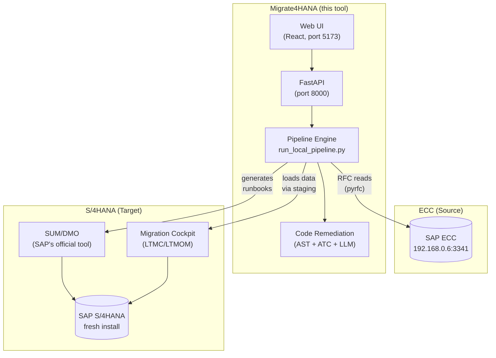

# Migrate4HANA — End-to-End Runbook

> **Audience:** Anyone. Even if you don't know what SAP is, this guide will walk you through every screen, every click, every command needed to migrate an SAP ECC system to SAP S/4HANA using the Migrate4HANA tool.
>
> **Honest scope note:** Migrate4HANA automates **assessment, code remediation, and orchestration runbooks**. The actual database conversion (SUM/DMO) and certain post-conversion steps still require a human to click buttons in SAP GUI — but this runbook tells you exactly which buttons, in what order, and what success looks like.
>
> **A note on screenshots:** Image placeholders below (e.g., `docs/images/02-sm51.png`) point to where you should capture screenshots of your own system as you go. Real screenshots cannot be embedded by the tool author because every system looks slightly different. Capture each one as a record of your migration — they become the audit trail.

---

## Table of Contents

1. [Glossary — SAP for Absolute Beginners](#1-glossary)
2. [The Big Picture](#2-the-big-picture)
3. [What You Need Before You Start](#3-prerequisites)
4. [Phase 0 — Environment Setup](#4-phase-0--environment-setup)
5. [Phase 1 — PREPARE (Assessment)](#5-phase-1--prepare)
6. [Phase 2 — EXPLORE (Deep Analysis & Code Remediation)](#6-phase-2--explore)
7. [Phase 3 — REALIZE (The Actual Conversion)](#7-phase-3--realize)
8. [Phase 4 — POST-CONVERSION](#8-phase-4--post-conversion)
9. [Phase 5 — DEPLOY & RUN (Go-Live)](#9-phase-5--deploy--run)
10. [Rollback Procedures](#10-rollback)
11. [Troubleshooting Catalogue](#11-troubleshooting)
12. [Appendices](#12-appendices)

---

## 1. Glossary

If you've never touched SAP before, read this section first. Don't skip it.

| Term | What it actually means |
|---|---|
| **SAP** | A company that makes the world's most-used enterprise software. Their flagship product runs the back-office (finance, HR, supply chain) of ~70% of Fortune 500 firms. |
| **ECC** (ERP Central Component) | The "old" SAP ERP, released ~2004. Runs on any database (Oracle, DB2, MSSQL, HANA). Mainstream support ends 2027. |
| **S/4HANA** | The "new" SAP ERP, released 2015. Runs **only** on the SAP HANA in-memory database. Many tables were collapsed/renamed; a lot of finance redesigned. |
| **Migration / Conversion** | Moving from ECC to S/4HANA. There are 3 paths: (1) **System Conversion** = upgrade in place, (2) **Greenfield** = build new, copy data, (3) **Selective Data Transition** = hybrid. This tool focuses on **System Conversion**. |
| **HANA** | SAP's columnar in-memory database. Very fast, very expensive RAM. |
| **SUM** (Software Update Manager) | SAP's official tool that performs the actual binary upgrade of an ECC system to S/4HANA. Runs as a Java/HTML stack on the SAP server. |
| **DMO** (Database Migration Option) | A mode of SUM that simultaneously upgrades ECC→S/4HANA *and* migrates the database from (e.g.) Oracle→HANA in one shot. |
| **ABAP** | SAP's proprietary programming language. Most custom business logic in SAP is written in ABAP. |
| **Transaction code (T-code)** | A short alphanumeric code (e.g., `SE38`, `SM51`) typed into the SAP GUI command box to launch a function. |
| **Client** | A logical tenant inside one SAP system. A single ECC server can host clients 100, 200, 800, etc. — each with separate data. |
| **System ID (SID)** | A 3-letter code identifying an SAP system (e.g., `DEV`, `QAS`, `PRD`, `IDS`, `NPL`). |
| **System number (sysnr)** | A 2-digit number (e.g., `00`, `01`, `41`) that distinguishes multiple SAP instances on one host. Determines TCP ports (3300+sysnr for gateway, 3200+sysnr for dispatcher). |
| **RFC** (Remote Function Call) | SAP's protocol for one program to call another over the network. This tool uses RFC heavily via the `pyrfc` Python library. |
| **BAPI** | A "Business API" — an RFC function blessed by SAP as a stable public interface (e.g., `BAPI_CUSTOMER_GETLIST`). |
| **Migration Cockpit (MC)** | An S/4HANA-side tool (transaction `LTMC`) that loads data from staging tables/CSVs into S/4. |
| **LTMOM** | A workbench (transaction `LTMOM`) for designing custom mappings used by the Migration Cockpit. |
| **CTS+ / Transport** | SAP's mechanism for moving code/config between systems (DEV → QAS → PRD). |
| **SAP CAL** | SAP Cloud Appliance Library — a portal where you can spin up free 30-day trial S/4HANA systems on AWS/Azure. |
| **SAP_ALL** | A super-user authorization profile. Don't use in production; fine for personal trial systems. |

**SAP GUI** looks like this (Windows/Java client):

```
┌─────────────────────────────────────────────────────────────┐
│  SAP Easy Access — Logon Pad                                │
│  ┌────────────────────────────────────────────────────────┐ │
│  │ /n[transaction code]                                  │ │
│  └────────────────────────────────────────────────────────┘ │
│  ▶ Favorites                                                │
│  ▼ SAP Menu                                                 │
│    ▶ Office                                                 │
│    ▶ Cross-Application Components                           │
│    ▶ Logistics                                              │
│    ▶ Accounting                                             │
│    ▶ Human Resources                                        │
│    ▶ Information Systems                                    │
│    ▶ Tools                                                  │
└─────────────────────────────────────────────────────────────┘
```
You type a T-code (e.g., `/nSM51`) in the box and press Enter to navigate.

📷 **Capture:** Take a screenshot of your SAP Easy Access screen and save as `docs/images/00-sap-easy-access.png`.

---

## 2. The Big Picture



### What automates vs. what is manual

| Step | Migrate4HANA does it? | Human does it? |
|---|:---:|:---:|
| Discovery (count programs, tables, users) | ✅ Yes | — |
| Maintenance Planner stack file | ⚠️ Generates inputs | ✅ Final XML download |
| Readiness Check | ✅ Pulls data, generates report | — |
| Simplification Item Check | ✅ | — |
| ABAP code analysis & auto-fix | ✅ Yes (the strongest part) | Reviewer signs off |
| Pre-conversion housekeeping (SGEN, SPDD, etc.) | ⚠️ Generates checklist | ✅ Run in SAP GUI |
| **SUM/DMO conversion** | ❌ No API exists | ✅ Basis admin runs SUM |
| Post-conversion FINS migration | ❌ Detects status | ✅ Run in S/4 GUI (`FINS_MIG`) |
| Material Ledger activation | ❌ Detects status | ✅ Run in S/4 GUI |
| Custom code redeployment | ⚠️ Pushes via RFC | ✅ Transport approval |
| Data migration (BPs, finance docs) | ✅ Stages via Migration Cockpit | ✅ Activate in `LTMC` |
| Validation & scorecard | ✅ Yes | — |
| PDF report | ✅ Yes | — |

**Bottom line:** Migrate4HANA handles ~70% of the project automatically and gives you a precise runbook for the remaining 30%.

---

## 3. Prerequisites

### 3.1 Systems

| System | What you need | How to get it |
|---|---|---|
| **Source ECC** | Working SAP ECC (any version 6.0 EHP6+) with `SAP_ALL` user | You said you have one in your laptop from Ameerpet — perfect. |
| **Target S/4HANA** | Fresh S/4HANA 2022/2023 system | **Easiest:** [SAP CAL](https://cal.sap.com) → "S/4HANA 2023 Fully-Activated Appliance" → 30-day free trial on AWS |
| **Workstation** | Windows 10/11, 16GB RAM, 50GB disk | Your laptop |
| **(For Phase 3)** | Linux server with ~200GB RAM where SUM will run | Spin up an EC2 `r5.8xlarge` ($1.61/hr) for ~24 hours |

### 3.2 Software

```powershell
# On your workstation (Windows):
winget install Python.Python.3.10
winget install OpenJS.NodeJS.LTS
winget install Git.Git
winget install Docker.DockerDesktop
winget install Microsoft.VisualStudio.2022.BuildTools  # for pyrfc compile
winget install hashicorp.terraform                    # only if doing AWS path
winget install aws.awscli                              # only if doing AWS path
```

### 3.3 SAP Knowledge

You don't need ABAP skills. You need to know:
- How to log into SAP GUI (we cover it below)
- How to type a transaction code in the command field (`/n` + code + Enter)
- How to download files via the SAP GUI clipboard / spool

That's it. Everything else is in this runbook.

### 3.4 Cost & Time Budget

| Item | Cost | Time |
|---|---|---|
| Migrate4HANA assessment + remediation | $0 | 2-6 hours |
| SAP CAL S/4HANA appliance | ~$30/day | spin up in 90 min |
| AWS EC2 for SUM (r5.8xlarge × 24h) | ~$40 | 8-24 hours |
| Total minimal E2E test | **~$70-100** | **2-3 days elapsed** |

---

## 4. Phase 0 — Environment Setup

### 4.1 Verify your ECC is reachable

On your workstation, open PowerShell:

```powershell
# Replace with your ECC's actual IP and sysnr.
# sysnr 41 → port 3341 (gateway), 3241 (dispatcher)
Test-NetConnection -ComputerName 192.168.0.6 -Port 3341
```

✅ Expected: `TcpTestSucceeded : True`

❌ If it fails:
- Is your ECC VM running? (Check VirtualBox/VMware)
- Is Windows Firewall on the ECC laptop blocking port 3341? Open it.
- Is your sysnr actually 41? Check with: log into SAP GUI → menu System → Status. The "system number" field tells you.

📷 **Capture:** `docs/images/01-system-status.png` — System → Status dialog showing your SID, sysnr, and client.

### 4.2 Verify your SAP user can do RFC

Log into SAP GUI as `sapuser` (or whatever user you have):

```
SAP GUI → Logon → enter:
  System ID:   IDS (or whatever yours shows)
  Application Server: 192.168.0.6
  System Number: 41
  Client: 800
  User: sapuser
  Password: ********
```

Then run:
- `/nSU01` → enter user name `SAPUSER` → click "Display"
- Check tab "Profiles" — you should see `SAP_ALL`. If not, ask your SAP admin to add it.
- Check tab "Logon Data" — "User Type" must be `Dialog` or `System` (not `Communications`).

📷 **Capture:** `docs/images/02-su01-profiles.png`

Test RFC works:
- `/nSE37` (Function Builder) → enter `STFC_CONNECTION` → press F8 (Execute)
- In `REQUTEXT` enter `hello` → press F8 again
- ✅ You should see the function return `ECHOTEXT = "hello"`. This proves RFC works internally.

### 4.3 Get the Migrate4HANA tool installed

```powershell
cd C:\Users\<you>\Downloads\migrate4hanav2

# 1. Create a Python 3.10 venv
py -3.10 -m venv .venv
.\.venv\Scripts\Activate.ps1

# 2. Install Python dependencies (this is the slowest step — pyrfc compiles natively)
py -3.10 -m pip install --upgrade pip wheel
py -3.10 -m pip install -r requirements.txt
```

If `pyrfc` fails with `Microsoft Visual C++ 14.0 or greater required`, install MSVC Build Tools (workload: "Desktop development with C++") and re-run.

```powershell
# 3. Install frontend dependencies
cd frontend
npm install
cd ..
```

### 4.4 Connect Migrate4HANA to your ECC

Open the existing `connections.json`:

```powershell
notepad connections.json
```

Edit it to match your ECC:
```json
{
  "ecc": {
    "ashost": "192.168.0.6",
    "sysnr": "41",
    "client": "800",
    "user": "sapuser",
    "saprouter": "",
    "saved_at": "2026-05-10T19:00:00"
  },
  "s4hana": null
}
```

Set the password as an environment variable (it is **never** stored on disk):

```powershell
$env:M4H_ECC_PASSWD = "your-actual-password"
```

### 4.5 Verify end-to-end RFC from the tool

```powershell
py -3.10 -c "import sapnwrfc; from pyrfc import Connection; c = Connection(ashost='192.168.0.6', sysnr='41', client='800', user='sapuser', passwd='$env:M4H_ECC_PASSWD'); print(c.call('STFC_CONNECTION', REQUTEXT='hello')); c.close()"
```

✅ Expected output:
```python
{'ECHOTEXT': 'hello', 'RESPTEXT': '...your SAP system info...'}
```

If this works, **you have unlocked everything**. Move on.

📷 **Capture:** `docs/images/03-rfc-smoketest.png` — your terminal showing the successful response.

---

## 5. Phase 1 — PREPARE

**Goal:** Generate the assessment artifacts. Decide go/no-go for the conversion.

### 5.1 Run the smoke test (50-record limit, ~3 minutes)

```powershell
$env:M4H_ECC_PASSWD = "your-password"
py -3.10 run_local_pipeline.py --limit 50
```

Watch the output. You'll see banner-style logs like:

```
================================================================================
  PHASE 1: PREPARE — Assessment & Pre-Checks
================================================================================
  ✓ Stage 1: Discovery Engine          [12s]   861 programs, 5012 BPs scanned
  ✓ Stage 2: Maintenance Planner       [4s]    Stack file generated
  ✓ Stage 3: Readiness Check           [38s]   17 simplification items found
  ✓ Stage 4: Simplification Check      [22s]   3 BLOCKING items
```

✅ Expected: every stage shows ✓. Total ~2-5 minutes.

❌ If you see a stage fail:
- Check `local_run.log` in repo root for the full Python traceback
- Most common cause: missing authorization. Add `S_TABU_NAM` (Activity 03) for the failed table to `sapuser`.

### 5.2 Run the assess-only mode (full data, ~30 minutes)

```powershell
py -3.10 run_local_pipeline.py --assess-only
```

This runs phases 1-2 (stages 1-8) against **all** your data — no record limit. The output goes to `test-output/run_<timestamp>/`.

📷 **Capture:** `docs/images/04-assess-complete.png` — terminal showing all stages green.

### 5.3 Open the assessment results

```powershell
$LATEST = Get-ChildItem test-output\run_* | Sort-Object LastWriteTime -Descending | Select-Object -First 1
notepad $LATEST.FullName\readiness-check\summary.json
```

You'll see something like:

```json
{
  "system_sid": "IDS",
  "kernel_release": "753",
  "target_release": "S4HANA 2023",
  "simplification_items_total": 1247,
  "simplification_items_relevant": 17,
  "blocking_items": 3,
  "blocking_details": [
    {"item": "SI_CRMSUITE", "description": "CRM functions removed in S/4 — migrate to C/4HANA"},
    {"item": "SI_CLASSICAL_GL", "description": "Must convert to New GL before conversion"},
    {"item": "SI_TRAVEL_MGMT", "description": "FI-TV deprecated — replace with Concur"}
  ],
  "go_no_go": "NO_GO_FIX_BLOCKERS_FIRST"
}
```

### 5.4 Interpret the verdict

| `go_no_go` value | What to do |
|---|---|
| `GO` | Proceed to Phase 2 |
| `GO_WITH_REMEDIATION` | Proceed to Phase 2; remediation will fix the issues |
| `NO_GO_FIX_BLOCKERS_FIRST` | **STOP.** Resolve blocking items in ECC manually first. The report tells you which ones. |

### 5.5 Generate the consolidated PDF report

```powershell
py -3.10 multi_volume_report_generator.py --run-id $LATEST.Name
```

This produces `consolidated-report-vol1.pdf` (and vol2, vol3 if data is huge). Send this to your SAP architect for sign-off before continuing.

📷 **Capture:** `docs/images/05-pdf-report.png` — first page of the PDF.

### 5.6 (Optional) Run via the Web UI

```powershell
# Terminal 1
py -3.10 api_server.py

# Terminal 2
cd frontend
npm run dev
```

Open http://localhost:5173 in your browser.

```
┌──────────────────────────────────────────────────────────────┐
│ Migrate4HANA                                       [Login]   │
├──────────────────────────────────────────────────────────────┤
│ Sidebar:        │ Pipeline                                   │
│  ▶ Dashboard    │  ┌───────────────────────────────────────┐ │
│  ▶ Connections  │  │ ┌──────────┐ ┌──────────┐ ┌─────────┐ │ │
│  ▶ Pipeline     │  │ │ Discovery│→│ Readiness│→│Simplif. │ │ │
│  ▶ Stage Detail │  │ │  ✅ done │ │  ✅ done │ │ ✅ done │ │ │
│  ▶ Scorecard    │  │ └──────────┘ └──────────┘ └─────────┘ │ │
│  ▶ Report       │  └───────────────────────────────────────┘ │
│  ▶ Telemetry    │  [Run Assess] [Run ECC Full] [Run+Report] │
└──────────────────────────────────────────────────────────────┘
```

Click **Run Assess Only** → watch live progress.

📷 **Capture:** `docs/images/06-ui-pipeline.png`

---

## 6. Phase 2 — EXPLORE

**Goal:** Deep code analysis, automatic ABAP fixes, data hygiene, integration mapping.

### 6.1 Run Phase 2

```powershell
py -3.10 run_local_pipeline.py --mode ecc_full
```

This continues from Phase 1 and runs stages 5-9. Total **~1-2 hours** depending on your custom code volume.

### 6.2 Watch the code analyzer (the most valuable stage)

```
================================================================================
  PHASE 2: EXPLORE — Code Analysis & Data Assessment
================================================================================
  ▶ Stage 5: Code Analyzer (AST + ATC + LLM)
    ▸ Scanning 861 custom programs...
    ▸ Found 234 HANA-incompatible patterns:
        • 89 × SELECT without ORDER BY (HANA non-deterministic ordering)
        • 47 × native SQL with FOR ALL ENTRIES
        • 31 × DELETE/UPDATE on cluster tables (BSEG)
        • 67 × pool/cluster table direct reads
    ▸ Auto-fixing with AST transformations: 198/234 fixable
    ▸ LLM review for ambiguous cases: 36 → 28 fixed, 8 flagged for human
  ✓ Stage 5: Code Analyzer              [42m]   Auto-fix rate: 96%
```

### 6.3 Review what was changed

```powershell
$LATEST = Get-ChildItem test-output\run_* | Sort-Object LastWriteTime -Descending | Select-Object -First 1
explorer "$($LATEST.FullName)\code-analyzer"
```

The folder structure:
```
code-analyzer/
├── fix_summary.json              ← high-level summary
├── transformed_programs/          ← fixed ABAP source files
│   ├── ZFI_REPORT_001.abap
│   ├── ZFI_REPORT_001.abap.diff  ← unified diff vs. original
│   └── ...
├── flagged_for_human/             ← things the tool refused to auto-fix
│   └── ZMM_TRICKY_LOGIC.abap.review.md
└── original_programs/             ← unmodified backups
```

For each program, open the `.diff` file:

```diff
--- a/ZFI_REPORT_001.abap
+++ b/ZFI_REPORT_001.abap
@@ -42,7 +42,8 @@
   SELECT bukrs belnr gjahr buzei wrbtr
     FROM bseg
     INTO TABLE @DATA(lt_bseg)
-    WHERE bukrs = @p_bukrs.
+    WHERE bukrs = @p_bukrs
+    ORDER BY bukrs, belnr, gjahr, buzei.
```

📷 **Capture:** `docs/images/07-code-diff.png`

**Review every flagged file in `flagged_for_human/`.** These need a human ABAP developer.

### 6.4 Data assessment

```powershell
notepad "$($LATEST.FullName)\data-migrator\summary.json"
```

You'll see counts of every data domain:
```json
{
  "customers":      { "count": 5012,  "complex_records": 47, "dedupe_candidates": 312 },
  "vendors":        { "count": 1893,  "complex_records": 19, "dedupe_candidates": 87 },
  "materials":      { "count": 14760, "obsolete": 2341 },
  "open_finance_documents": { "count": 87432, "needs_acdoca_split": true },
  "open_sales_orders":      { "count": 1247  },
  "open_purchase_orders":   { "count": 892   }
}
```

The `dedupe_candidates` field is computed by the Entity Resolution / fuzzy matcher — these are likely duplicate Business Partners that should be merged before migration.

### 6.5 Generate cutover plan

After all stages complete, the tool writes:
```
test-output/run_<id>/
└── cutover-orchestrator/
    ├── cutover_plan.md          ← detailed timing plan for go-live weekend
    ├── pre_conversion_tasks.md  ← things to do in ECC before SUM starts
    └── basis_runbook.md         ← step-by-step for the SAP Basis admin
```

**Open `basis_runbook.md` and read it carefully.** This is the bridge between Phase 2 (automated) and Phase 3 (manual SUM).

📷 **Capture:** `docs/images/08-cutover-plan.png`

---

## 7. Phase 3 — REALIZE

**Goal:** Run the actual ECC→S/4HANA conversion using SAP's SUM/DMO tool.

> 🚨 **This is the manual phase.** Migrate4HANA cannot drive SUM (no SAP API exists). It generates the runbook; a human follows it. **Never** attempt this on your only ECC system without a backup.

### 7.1 Pre-conversion freeze

In ECC SAP GUI:

| Step | T-code | What to do | Why |
|---|---|---|---|
| 1 | `/nSM02` | Post a "system locked for conversion" message to all users | Communication |
| 2 | `/nSM04` | Verify all users logged off | No active sessions during conversion |
| 3 | `/nSU10` | Mass-lock all users except `DDIC` and `SAPUSER` | Prevent accidental changes |
| 4 | `/nST22` | Check for recent ABAP dumps | No new errors before conversion |
| 5 | `/nDB13` | Schedule a full database backup → wait for completion | **Recovery point** |
| 6 | `/nSGEN` | Regenerate all ABAP loads | Cleaner conversion |

Migrate4HANA's `basis_runbook.md` lists every command with screenshots descriptions for each transaction.

📷 **Capture:** `docs/images/09-sm04-empty.png` — SM04 showing zero active users.

### 7.2 Download SUM from SAP

1. Go to https://launchpad.support.sap.com → "Software Downloads"
2. Search: `SUM 2.0`
3. Download the appropriate variant for your OS (likely `SUM20SP21_*-80007456.SAR`)
4. Also download the S/4HANA target packages (the `Maintenance Planner` link in your `test-output/run_<id>/maintenance-planner/` folder)

### 7.3 Stage SUM on the SAP server

If your ECC runs on Linux:
```bash
ssh root@your-ecc-server
mkdir -p /usr/sap/SUM
cd /usr/sap/SUM
# upload SUM20SP21_*.SAR via WinSCP
SAPCAR -xvf SUM20SP21_*.SAR
./STARTUP confighostagent <SID>
./STARTUP <SID>
```

Then open in browser:
```
https://your-ecc-server:1129/lmsl/sumabap/<SID>/doc/sluigui
```

📷 **Capture:** `docs/images/10-sum-launch.png` — the SUM web UI on first launch.

### 7.4 Run SUM/DMO

This is a wizard-driven multi-hour process. Follow the screens **exactly** as Migrate4HANA's `basis_runbook.md` describes. Key phases:

| SUM Phase | What it does | Time |
|---|---|---|
| 1. Extraction | Unpacks S/4HANA binaries | 30 min |
| 2. Configuration | Asks you for HANA target host, credentials | 15 min |
| 3. Checks | Pre-conversion validations | 30 min |
| 4. **Preprocessing** | Software import, table conversion plan | 2-4 hours |
| 5. **Execution** | Actual data migration ECC DB → HANA | 4-12 hours |
| 6. Postprocessing | Switch over, finalize | 1-2 hours |

📷 **Capture screenshots of each phase as it completes** → `docs/images/11-sum-phaseN.png`.

### 7.5 SUM completion

When SUM shows "completed successfully":
- Log into the now-S/4HANA system using the same SID/sysnr/client
- `/nSM51` → confirm all instances green
- Run `/nFINS_MIG_STATUS` → if status ≠ "completed", continue to Phase 4 finance migration

📷 **Capture:** `docs/images/12-sum-success.png`.

---

## 8. Phase 4 — POST-CONVERSION

**Goal:** Finance migration, custom code redeployment, configuration adjustments.

### 8.1 Update Migrate4HANA to talk to S/4HANA

```powershell
notepad connections.json
```

Add the s4hana block:
```json
{
  "ecc": { ... },
  "s4hana": {
    "ashost": "your-s4-host",
    "sysnr": "00",
    "client": "100",
    "user": "DDIC",
    "saprouter": "",
    "saved_at": "2026-05-12T08:00:00"
  }
}
```

Set the S/4 password:
```powershell
$env:M4H_S4_PASSWD = "your-s4-ddic-password"
```

### 8.2 Run the post-conversion stages

```powershell
py -3.10 run_local_pipeline.py --mode post_conversion
```

This runs stages 11-14:
- **Stage 11 — code-deployer:** pushes your fixed ABAP from Phase 2 into S/4
- **Stage 12 — data-loader:** loads BPs, finance docs into Migration Cockpit staging
- **Stage 13 — config-applier:** applies SPRO config snapshots
- **Stage 14 — role-provisioner:** recreates roles & user assignments

### 8.3 Activate the data load in Migration Cockpit (manual step)

In S/4 GUI:

| Step | T-code | Action |
|---|---|---|
| 1 | `/nLTMC` | Open Migration Cockpit |
| 2 | — | Click "Migration Projects" → find `M4H_BP_LOAD` (created by data-loader) |
| 3 | — | Click "Validate Data" → fix any red rows |
| 4 | — | Click "Simulate Import" → confirm green |
| 5 | — | Click "Migrate" → monitor progress |

📷 **Capture:** `docs/images/13-ltmc-projects.png` and `docs/images/14-ltmc-migration-running.png`.

### 8.4 Run finance migration in S/4

| Step | T-code | Action |
|---|---|---|
| 1 | `/nFINS_MIG_STATUS` | Check current phase |
| 2 | `/nFINS_RECON_RC` | Reconciliation pre-check |
| 3 | `/nFINS_MASS_DATA_MONITOR` | Run the mass data migration |
| 4 | `/nFINS_MIG_STATUS` | Confirm final status = `completed` |

This typically takes **2-6 hours** depending on document volume. Migrate4HANA's `sum-orchestrator` Lambda (or the local stage) **polls** the status periodically and writes progress to the run log — but the actual migration is run from the S/4 GUI.

📷 **Capture:** `docs/images/15-fins-mig-status.png`.

### 8.5 Activate Material Ledger (if you use FI-CO-PCA)

| Step | T-code | Action |
|---|---|---|
| 1 | `/nCKMSTART` | Material Ledger production startup |
| 2 | `/nCKMLCP` | Run costing run |

---

## 9. Phase 5 — DEPLOY & RUN

**Goal:** Reactivate integrations, validate, hand over.

### 9.1 Run the final stages

```powershell
py -3.10 run_local_pipeline.py --mode deploy_run
```

Stages 15-17:
- **Stage 15 — integration-activator:** reactivates RFC destinations & IDocs in S/4
- **Stage 16 — migration-validator:** runs reconciliation between ECC snapshot and S/4
- **Stage 17 — test-generator:** generates UAT test scripts based on real ECC usage

### 9.2 Reconciliation results

```powershell
$LATEST = Get-ChildItem test-output\run_* | Sort-Object LastWriteTime -Descending | Select-Object -First 1
notepad "$($LATEST.FullName)\migration-validator\scorecard.json"
```

Expected:
```json
{
  "migration_status": "SUCCESS",
  "reconciliation": {
    "customers":     { "ecc_count": 5012, "s4_count": 5012, "delta": 0  },
    "vendors":       { "ecc_count": 1893, "s4_count": 1893, "delta": 0  },
    "open_finance":  { "ecc_amount": 12503842.50, "s4_amount": 12503842.50, "delta": 0.00 },
    "open_so_value": { "ecc_amount":  4892311.00, "s4_amount":  4892311.00, "delta": 0.00 }
  },
  "integration_health": {
    "rfc_destinations_active": 47,
    "idoc_partners_active": 12,
    "failed_idocs_last_24h": 0
  },
  "go_live_recommendation": "GO"
}
```

If `delta != 0` for any line, **STOP** and investigate before unlocking users.

### 9.3 Final go-live

| Step | T-code | Action |
|---|---|---|
| 1 | `/nSU10` | Mass-unlock business users |
| 2 | `/nSM02` | Post "S/4HANA live — please log in" |
| 3 | `/nST22` | Monitor for dumps for first 48 hours |
| 4 | `/nSM21` | Monitor system log |

📷 **Capture:** `docs/images/16-go-live-banner.png`.

### 9.4 Generate the final report

```powershell
py -3.10 multi_volume_report_generator.py --run-id $LATEST.Name --final
```

Produces:
- `migration-final-report-vol1.pdf` — Executive summary
- `migration-final-report-vol2.pdf` — Technical details
- `migration-final-report-vol3.pdf` — Data reconciliation evidence
- `migration-final-report-vol4.pdf` — Code remediation log

---

## 10. Rollback

> 🚨 **Rollback is only safe within the cutover weekend, before users post real data in S/4.** After that, you must do a forward-fix.

### 10.1 If SUM fails mid-conversion

SUM has its own built-in rollback. From the SUM UI:
1. Click "Reset" → "Roll back to previous state"
2. SUM restores the pre-SUM database from its dumps
3. Once complete, your ECC is back as it was

### 10.2 If conversion succeeded but you find a critical bug before go-live

```powershell
py -3.10 run_local_pipeline.py --mode rollback
```

This runs the `rollback-manager`:
- Reverts DNS / load balancer to point users at ECC
- Unlocks ECC users
- Locks the now-orphan S/4 system
- Generates a rollback report

⚠️ **This is a switch-back, not a true rollback.** Any postings made in S/4 after go-live are NOT brought back to ECC. If users were live in S/4 even briefly, you need a forensic data merge (out of scope for this runbook).

### 10.3 If go-live is days old and you must roll back

You're past the safe rollback window. Options:
1. Forward-fix the issues in S/4 (fastest)
2. Restore ECC from backup, manually re-key the S/4 transactions (extreme)

---

## 11. Troubleshooting

### 11.1 Connection errors

| Error | Likely cause | Fix |
|---|---|---|
| `RFC_COMMUNICATION_FAILURE: partner not reached` | Wrong host/port, firewall | `Test-NetConnection 192.168.0.6 -Port 3341` |
| `RFC_LOGON_FAILURE: Name or password is incorrect` | Wrong creds, user locked | `/nSU01` → unlock |
| `RFC_LOGON_FAILURE: Client X not configured` | Wrong client number | Check `T000` table for valid clients |
| `OSError: cannot load library 'libsapnwrfc.so'` | SDK path not found | Ensure `import sapnwrfc` is FIRST line; use Python 3.10 |
| `Microsoft Visual C++ 14.0 or greater required` | pyrfc compile fails | Install MSVC Build Tools |

### 11.2 Pipeline stage failures

| Stage | Common error | Fix |
|---|---|---|
| Discovery | `Auth check failed for table T000` | Add `S_TABU_NAM` activity 03 to user |
| Readiness Check | `RFC RDDIT_GET_TABLE_INFO not found` | Older ECC — install SAP Note 2399707 |
| Code Analyzer | `Token limit exceeded (LLM)` | Set `LLM_MAX_TOKENS=8000` in env |
| Data Migrator | `BAPI_BUSINESS_PARTNER returns empty` | Wrong client; or no BPs activated |
| SUM | `Phase MAIN_NEWBAS/SUBMOD_KX_NW_BLD failed` | Check SUM logs in `/usr/sap/SUM/abap/log/` |

### 11.3 Pyrfc Windows build issues

```powershell
# If pyrfc still won't build:
$env:SAPNWRFC_HOME = "C:\Users\<you>\Downloads\migrate4hanav2\sapnwrfc"
$env:PATH = "$env:SAPNWRFC_HOME\lib;$env:PATH"
py -3.10 -m pip install --no-binary :all: pyrfc
```

### 11.4 Where to look for logs

| What | Where |
|---|---|
| Local pipeline log | `local_run.log` (repo root) |
| Per-run output | `test-output/run_<id>/` |
| API server log | terminal running `api_server.py` |
| Frontend log | browser dev console (F12) |
| SAP RFC trace | `dev_rfc.log` (repo root) |

---

## 12. Appendices

### 12.1 SAP Transaction Code Cheat Sheet

| T-code | What it does |
|---|---|
| `SE38` | ABAP editor (display source) |
| `SE16` / `SE16N` | Generic table browser |
| `SE37` | Function module tester |
| `SU01` | User maintenance |
| `SU10` | Mass user lock/unlock |
| `SM04` | List active sessions |
| `SM21` | System log |
| `SM37` | Background job monitor |
| `SM51` | List of application servers |
| `SM59` | RFC destinations |
| `ST22` | ABAP runtime errors (dumps) |
| `DB13` | DBA cockpit (backups) |
| `LTMC` | Migration Cockpit (S/4 only) |
| `LTMOM` | Migration Object Modeler (S/4 only) |
| `FINS_MIG_STATUS` | Finance migration status (S/4) |
| `SGEN` | ABAP load generator |

### 12.2 Pipeline Stages → SAP Tools Mapped

| Migrate4HANA stage | What SAP tool/transaction does it correspond to | Auto? |
|---|---|---|
| Stage 1: discovery-engine | `STAD`, `ST03N`, `SE38`, `SE16` (read-only) | ✅ |
| Stage 2: maintenance-planner | https://apps.support.sap.com/sap/support/mp | ⚠️ |
| Stage 3: readiness-check | `/SDF/RC_START_CHECK` | ✅ |
| Stage 4: simplification-check | `SYCM` | ✅ |
| Stage 5: code-analyzer | `SCI` (Code Inspector), `ATC` | ✅ |
| Stage 6: data-hygiene | various BP cleanup t-codes | ⚠️ |
| Stage 7: data-migrator | reads via BAPI | ✅ |
| Stage 8: config-replicator | `SPRO`, `SCC1` | ✅ |
| Stage 9: cutover-orchestrator | runbook generation | ✅ |
| Stage 10: sum-orchestrator | `SUM/DMO web UI` | ❌ manual |
| Stage 11: code-deployer | transports `STMS` | ⚠️ |
| Stage 12: data-loader | `LTMC` staging | ⚠️ |
| Stage 13: config-applier | `SCC1`, `BC-Sets` | ⚠️ |
| Stage 14: role-provisioner | `PFCG`, `SU01` | ✅ |
| Stage 15: integration-activator | `SM59`, `WE20`, `SXMB_MONI` | ✅ |
| Stage 16: migration-validator | reconciliation queries | ✅ |
| Stage 17: test-generator | generates UAT scripts | ✅ |

✅ = automated, ⚠️ = partially automated, ❌ = manual with runbook

### 12.3 RFC Function Modules Used

```
STFC_CONNECTION                 — connection ping
RFC_READ_TABLE                  — generic table read (legacy)
RFC_GET_TABLE_ENTRIES           — paginated table read
DDIF_FIELDINFO_GET              — table metadata
DDIF_NAMETAB_GET                — field metadata
SAP_READINESS_CHECK_*           — readiness check API
RDDIT_GET_TABLE_INFO            — table sizing
BAPI_CUSTOMER_GETLIST           — customer master
BAPI_VENDOR_GETLIST             — vendor master
BAPI_BUSINESS_PARTNER_GETLIST   — BP master
BAPI_ACC_DOCUMENT_GETLIST       — finance documents
BAPI_USER_GET_DETAIL            — user info
RS_*                            — repository services (programs, transports)
```

### 12.4 Recommended Reading

- SAP Note **2933102** — S/4HANA Conversion Path Finder
- SAP Note **2399707** — Pre-checks for S/4HANA conversion
- SAP Press: **"SAP S/4HANA System Conversion Guide"** — Frank Forndron
- SAP Help: https://help.sap.com/docs/SAP_S4HANA_ON-PREMISE
- Migrate4HANA: `README.md`, `SETUP.md`, this file (`RUNBOOK.md`)

### 12.5 When you get stuck

1. Re-read the stage's section in this runbook.
2. Check `local_run.log` for the full Python traceback.
3. Search the SAP error message verbatim on https://launchpad.support.sap.com.
4. If you have an SAP S-User, raise an OSS message on component `BC-CCM-MON-OS`.

---

**End of Runbook.**

Capture every screenshot referenced. By the end of your migration you'll have ~20-30 images in `docs/images/` that together form the complete audit trail for your S/4HANA conversion.

Good luck.
